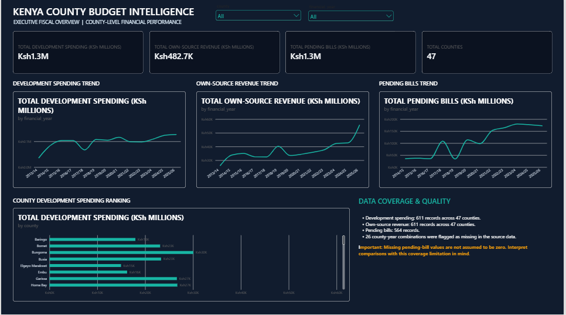

# Kenya County Budget Intelligence

### A Data Analytics Project | Public Finance | Kenya

## Project Overview

Kenya County Budget Intelligence is an end-to-end data analytics project designed to examine county-level public finance performance across Kenya's 47 counties.

The project analyzes three key areas of county finances:

- Development spending
- Own-source revenue
- Pending bills

Using Python, SQL, Excel and Power BI, the project transforms raw financial data into structured datasets, performs analytical queries and presents findings through an interactive dashboard.

The objective is to make county financial information easier to explore, compare and interpret, supporting data-driven discussions around public spending, revenue generation and outstanding financial obligations.

## Dashboard Preview



## Business Questions

This project explores the following questions:

1. How does county development spending change across financial years?
2. How does own-source revenue compare across counties and years?
3. Which counties have the highest development spending?
4. How do pending bills vary across counties?
5. What patterns emerge when county financial performance is compared over time?

## Tools and Technologies

| Tool | Application |
|---|---|
| Python | Data cleaning and transformation |
| PostgreSQL | Data storage and SQL analysis |
| Power BI | Interactive dashboard and visualization |
| Excel | Data review and analysis |
| VS Code | Development environment |
| GitHub | Project version control and documentation |

## Data Preparation and Methodology

The project followed a structured analytical workflow:

1. **Data preparation:** Inspected and transformed the original financial datasets using Python.
2. **Data cleaning:** Standardized the datasets into a consistent county-year structure.
3. **Database development:** Imported the prepared datasets into PostgreSQL.
4. **SQL analysis:** Queried county-level and financial-year performance.
5. **Data modelling:** Created shared county and financial-year dimensions in Power BI.
6. **Visualization:** Developed an interactive dashboard with KPI cards, financial trends, county comparisons and slicers.

## Dataset Coverage

The analytical datasets cover:

| Financial indicator | Records | County coverage |
|---|---:|---:|
| Development spending | 611 | 47 |
| Own-source revenue | 611 | 47 |
| Pending bills | 564 | 47 |

The datasets contain up to 13 financial years of records.

**Data quality consideration:** The pending bills dataset contains 26 missing county-year combinations. These are treated as missing observations rather than assumed zero values.

## Dashboard Features

The Power BI dashboard includes:

- Total development spending
- Total own-source revenue
- Total pending bills
- Total counties covered
- Financial-year trend analysis
- County-level comparisons
- Interactive county filter
- Interactive financial-year filter

The interactive filters allow users to explore financial performance by county and financial year.

## Project Structure

```text
Kenya County Budget Intelligence/
│
├── Kenya_County_Budget_Intelligence.pbip
├── Kenya_County_Budget_Intelligence_Dashboard.png
│
├── Python/
├── SQL/
├── Excel/
├── Power BI/
├── Data/
└── README.md
```

*The folder structure above provides an overview; individual folders contain the relevant project files and supporting materials.*

## Key Analytical Value

This project demonstrates the application of data analytics to public financial information, including:

- Data cleaning and transformation
- Relational database management
- SQL-based data analysis
- Data modelling
- Interactive business intelligence reporting
- Data quality assessment
- Financial trend and comparative analysis

## Conclusion

Kenya County Budget Intelligence demonstrates how multiple data tools can be combined to turn public financial datasets into an accessible analytical solution.

By bringing development spending, own-source revenue and pending bills into one interactive reporting environment, the project provides a foundation for exploring county financial performance and identifying areas that may require further investigation.

---

**Project Category:** Data Analytics | Business Intelligence | Public Finance

**Tools:** Python | PostgreSQL | SQL | Power BI | Excel